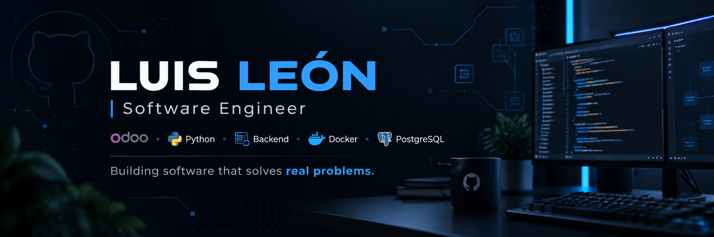

  

## 👋 Sobre mí

Desarrollo soluciones empresariales y productos digitales enfocados en resolver problemas reales, desde personalizaciones y ecosistemas Odoo hasta APIs, herramientas para desarrolladores y aplicaciones multiplataforma.

Mi trabajo se centra principalmente en **Python, Odoo, PostgreSQL, Docker y Flutter**, con especial interés en arquitectura backend, automatización y productos SaaS.

---

## 🎯 Actualmente

- 🔭 Construyendo herramientas y productos propios
- 🐍 Profundizando en Python y arquitectura backend
- 🐳 Automatizando entornos de desarrollo con Docker
- 🧩 Desarrollando soluciones empresariales sobre Odoo
- 📱 Explorando soluciones multiplataforma con Flutter

---

## 🛠️ Tech Stack

### Core

  
  
  
  
  

### Additional

  
  
  
  
  
  
  
  

---

## 📌 Proyectos destacados

<table>
  <tr>
    <td width="50%" valign="top">
      <h3>🔎 <a href="https://github.com/LuAn-LeOn/portscope">PortScope</a></h3>
      

        Herramienta multiplataforma para analizar puertos, procesos y servicios activos
        de una manera visual y sencilla.
      

      
<code>Python</code> <code>Networking</code> <code>Developer Tools</code>

    </td>
    <td width="50%" valign="top">
      <h3>🐳 odooenv</h3>
      

        CLI para crear, levantar y administrar entornos de desarrollo Odoo utilizando
        Docker y PostgreSQL.
      

      
<code>Python</code> <code>Odoo</code> <code>Docker</code> <code>PostgreSQL</code>

      
🚧 Proyecto actualmente en desarrollo. Próximamente disponible en GitHub.

    </td>
  </tr>
  <tr>
    <td width="50%" valign="top">
      <h3>📅 Sitenda</h3>
      

        Plataforma SaaS enfocada en digitalizar negocios mediante sitio web, agenda,
        servicios, clientes y administración de citas.
      

      
<code>Django</code> <code>PostgreSQL</code> <code>Redis</code> <code>Celery</code> <code>Docker</code>

      
🚧 Proyecto actualmente en desarrollo. Próximamente disponible en GitHub.

    </td>
    <td width="50%" valign="top">
      <h3>🏥 Clinic Management</h3>
      

        Solución de gestión clínica desarrollada sobre Odoo para administrar pacientes,
        consultas médicas, recetas y procesos administrativos.
      

      
<code>Odoo</code> <code>Python</code> <code>PostgreSQL</code>

      
🔒 Repositorio privado.

    </td>
  </tr>
</table>

---

## 🤝 ¿Trabajamos juntos?

Si tienes un proyecto, una oportunidad profesional o simplemente quieres hablar sobre tecnología, puedes encontrarme aquí:

  
  

